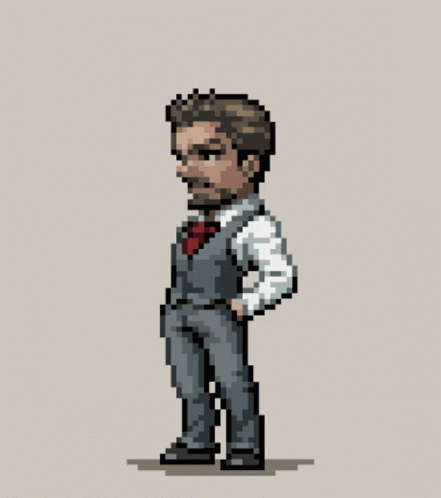

  
  <h1>Salut, moi c’est Dayane</h1>
  
<a href="https://github.com/DayaneOROU"><strong>@DayaneOROU</strong></a> · Développement web · apprendre en construisant · projets concrets

  

    
    
    
  

---

## Qui suis-je ?

<table>
  <tr>
    <td width="72%" valign="middle">
      
Je m’appelle Dayane, et j’aime voir une idée passer de “ce serait sympa” à quelque chose qui fonctionne vraiment. Le développement me plaît pour ce mélange de réflexion et de créativité : on imagine, on essaie, on ajuste, et peu à peu le projet prend sa forme. Sur cette page, je rassemble les projets qui m’ont appris quelque chose, les idées que j’explore et les petites victoires du chemin. Tout n’a pas besoin d’être parfait pour mériter d’être montré — parfois, le plus intéressant, c’est justement ce qu’on découvre en le construisant.

    </td>
    <td width="28%" align="center" valign="middle">
      
    </td>
  </tr>
</table>

## Ce que vous trouverez ici

<table>
  <tr>
    <td width="72%" valign="middle">
      
Un peu de code, beaucoup d’essais, et des projets qui partent souvent d’une question simple : “Et si je le faisais moi-même ?” J’aime apprendre en fabriquant quelque chose de concret, puis améliorer les détails jusqu’à ce que l’ensemble soit clair et agréable à utiliser. Certains projets sont terminés, d’autres évoluent encore. Chacun raconte une étape de mon parcours et m’a appris une nouvelle façon de résoudre un problème. Si l’un d’eux vous intrigue, j’espère qu’il vous donnera envie d’y jeter un œil — ou de venir en discuter.

    </td>
    <td width="28%" align="center" valign="middle">
      
    </td>
  </tr>
</table>

---

## Technologies

  
  
  

**Frontend** · TypeScript · Vite · Tailwind CSS 4 · Shadcn UI · Axios  
**Données et intégrations** · MySQL / MariaDB · Supabase · API REST · FedaPay · Google OAuth  
**Outils** · Git / GitHub · Postman

  
<strong>En apprentissage</strong>

   
  Java SE · JPA / TopLink · Oracle PL/SQL / APEX · Python · Tkinter · k-means

---

## Projets phares

### [BeninTravel](https://benintravel.vercel.app)

Explorez les destinations et itinéraires du Bénin, des palais royaux aux musées, au divertissement et aux traditions vivantes, avec des itinéraires sur mesure proposés par l’équipe.

### [BeautyProjet](https://github.com/DayaneOROU/BeautyProjet)

Dépôt public en TypeScript, organisé en deux dossiers : `beauty-admin` et `beauty-store`.

---

## Statistiques GitHub

  
  

## Me contacter

Ajoute ici uniquement les moyens de contact que tu souhaites rendre publics.

<!-- Exemples à compléter puis décommenter selon les liens choisis :
[Email](mailto:ADRESSE_EMAIL) · [LinkedIn](URL_LINKEDIN) · [Portfolio](URL_PORTFOLIO)
-->

---

  Conçu en apprenant, construit avec curiosité.

<!--
Bannières alternatives : remplacer assets/banner-cycle.gif par assets/banner-action.gif
ou assets/banner-pose.gif dans la première image.
GitHub ne permet pas d’exécuter du JavaScript dans le README de profil; les deux séquences
sont donc réunies dans une seule animation qui boucle, plutôt que choisies au hasard au chargement.
Le thème de fond de la page reste celui choisi par la personne qui consulte GitHub; les badges,
la bannière et les cartes de statistiques prévues apportent les accents sombres, rouges et or.
-->
