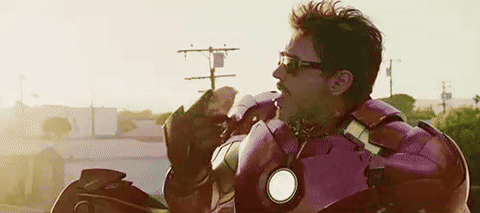
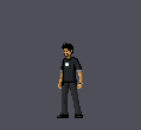

<!--
  Palette Iron Man :
  rouge  B71C1C (fond des badges) / DC2626 (accents)
  or     F2B233
  fond   0D1117
-->

  <!-- Bannière : GitHub choisit l'image selon le thème du visiteur (sombre ou clair).
       Le fichier du  sert de secours si le navigateur ne gère pas <picture>. -->
  <picture>
    <source media="(prefers-color-scheme: dark)" srcset="assets/banner-action.gif" />
    <source media="(prefers-color-scheme: light)" srcset="assets/banner-pose.gif" />
    
  </picture>

   

  <!-- Badges sous la bannière : ils passent à la ligne tout seuls sur mobile -->
  
  
  

 

<!-- ============ BLOC 1 : GIF à gauche, texte à droite ============ -->

<h2 align="center">Qui suis-je ?</h2>

<table>
  <tr>
    <td width="24%" align="center" valign="middle">
      
    </td>
    <td width="76%" valign="middle">
      
Je m’appelle Dayane, et j’aime voir une idée passer de “ce serait sympa” à quelque chose qui fonctionne vraiment. Le développement me plaît pour ce mélange de réflexion et de créativité : on imagine, on essaie, on ajuste, et peu à peu le projet prend sa forme.

      
Un peu de code, beaucoup d’essais, et des projets qui partent souvent d’une question simple : “Et si je le faisais moi-même ?” Certains sont terminés, d’autres évoluent encore. Chacun raconte une étape de mon parcours et m’a appris une nouvelle façon de résoudre un problème.

    </td>
  </tr>
</table>

<!-- ============ BLOC 2 : liste à gauche, GIF à droite ============ -->

<h2 align="center">Un peu plus sur moi</h2>

<table>
  <tr>
    <td width="76%" valign="middle">

- [x] J’aime transformer une idée en quelque chose qui fonctionne vraiment
- [x] J’apprends en construisant des projets concrets
- [x] Actuellement : Laravel, React et Next.js
- [x] En apprentissage : Java SE, JPA, Oracle PL/SQL et Python
- [x] Toujours partant pour discuter code et idées

    </td>
    <td width="24%" align="center" valign="middle">
      
    </td>
  </tr>
</table>

<!-- Icônes de contact : remplace les valeurs en MAJUSCULES, puis supprime les marqueurs de commentaire

  
  
  

-->

---

<!-- ============ STATISTIQUES ============ -->
<!-- Largeurs fixes SANS hauteur : côte à côte sur ordinateur, empilées sur mobile -->

<h2 align="center">GitHub Status</h2>

  
  

  

---

<!-- ============ STACK ============ -->

<h2 align="center">Mes stacks</h2>

  

  Shadcn UI · Axios · API REST · FedaPay · Google OAuth · Oracle PL/SQL / APEX · JPA / TopLink

---

<!-- ============ PROJETS ============ -->

<h2 align="center">Mes meilleurs projets</h2>

  
  

  <a href="https://benintravel.vercel.app"><strong>BeninTravel</strong></a> · explorez les destinations et itinéraires du Bénin, des palais royaux aux traditions vivantes.

 

  Conçu en apprenant, construit avec curiosité.

